<div dir="rtl">

<h1 align="center">🧩 SmartAAC</h1>

<h3 align="center">נותנים קול לילדים שלא מדברים.</h3>

<p align="center">
  מערכת דיגיטלית לילדים עם קשיי דיבור ומוגבלויות תקשורתיות,<br />
  בשילוב ממשק מעקב להורים ולצוות החינוכי.
</p>

<p align="center">
  <a href="https://smart-aac.vercel.app"></a>
</p>

<p align="center">
  
  
  
  
  
  
</p>

<p align="center">
  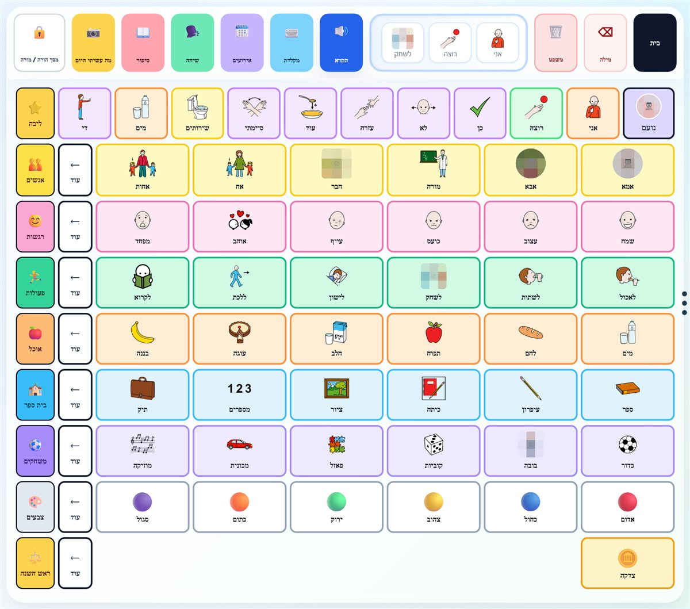
  <br />
  <sub>הילד לחץ "אני · רוצה · לשחק", והמשפט נבנה בשורה העליונה ומוקרא בקול.</sub>
</p>

---

<table>
  <tr>
    <td align="center" width="33%">
      <h3>🗣️</h3>
      <b>הילד מדבר</b><br />
      <sub>בונה משפטים מסמלים, והמכשיר מקריא אותם בקול בעברית</sub>
    </td>
    <td align="center" width="33%">
      <h3>🤖</h3>
      <b>ה-AI משחק איתו</b><br />
      <sub>שיחה שעונה בקול, וסיפור חדש בכל פעם</sub>
    </td>
    <td align="center" width="33%">
      <h3>👀</h3>
      <b>ההורה והמורה רואים הכל</b><br />
      <sub>אותו ילד, אותם נתונים, מעקב התקדמות משותף</sub>
    </td>
  </tr>
</table>

## 🚀 נסו בעצמכם, בלי הרשמה

<table>
  <tr>
    <td align="center" width="220">
      <a href="https://smart-aac.vercel.app">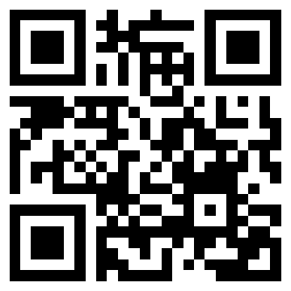</a>
      <br /><b>📱 סרקו בטלפון</b>
    </td>
    <td>
      <b>1.</b> נכנסים ל-<a href="https://smart-aac.vercel.app"><b>smart-aac.vercel.app</b></a><br /><br />
      <b>2.</b> לוחצים <b>"כניסת הורה / מורה"</b> ומקלידים קוד ילד <code>AAC-2026</code><br /><br />
      <b>3.</b> סיסמה <code>Demo2026</code> כדי להיכנס כ<b>הורה</b>, או <code>Demo2027</code> כדי להיכנס כ<b>מורה</b><br /><br />
      <b>🧒 רוצים לראות רק את הצד של הילד?</b> "כניסת ילד/ה" ← "פתיחת לוח התקשורת"
    </td>
  </tr>
</table>

---

## 💡 למה SmartAAC?

אפליקציות תת״ח (תקשורת תומכת וחליפית) קיימות הן בעיקר **לוח סמלים שמקריא מילים**. הילד לוחץ על אותם סמלים שוב ושוב, ומה שקורה בבית לא מגיע לבית הספר.

| | אפליקציית תת״ח רגילה | **SmartAAC** |
|---|:---:|:---:|
| לוח סמלים שמקריא בקול | ✅ | ✅ |
| שיחה עם AI שעונה לילד בקול | ❌ | ✅ |
| סיפור חדש בכל פעם | ❌ | ✅ |
| סמלים שמותאמים לאירועים ולתמונות מהיום | ❌ | ✅ |
| הורה ומורה עובדים יחד על אותו ילד | ❌ | ✅ |
| מעקב התקדמות | ❌ | ✅ |
| טלפון, טאבלט ומחשב, בלי התקנה | ❌ | ✅ |

---

## 🧒 הצד של הילד

<table>
  <tr>
    <td width="55%">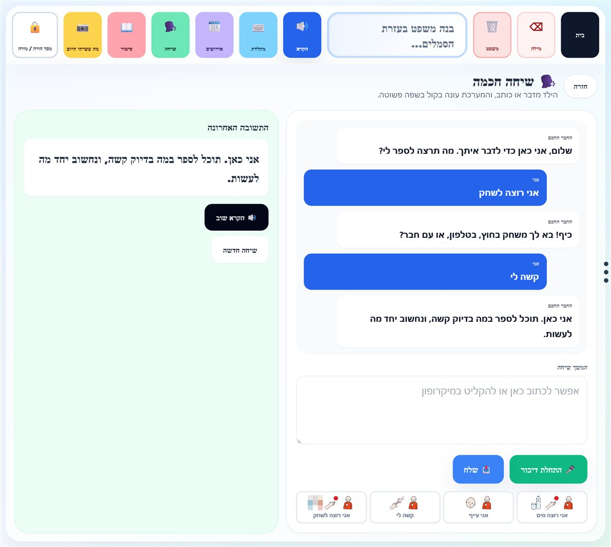</td>
    <td width="45%" valign="middle">
      <h3>🗣️ שיחה חכמה</h3>
      גם ילד שלא מדבר בכלל יכול לנהל שיחה: הוא לוחץ על משפט מוכן בתמונה, ה-AI עונה לו <b>בקול ובשפה פשוטה</b>, והוא ממשיך עם כפתורים.<br /><br />
      <sub>ילד שיודע לכתוב יכול להקליד, וילד שמדבר חלקית יכול להקליט.</sub>
    </td>
  </tr>
  <tr>
    <td width="45%" valign="middle">
      <h3>🗓️ לוח אירועים</h3>
      מה קורה השבוע: טיול, יום הולדת, הצגה. <b>ה-AI בוחר לכל אירוע את הסמלים שמתאימים לו</b>, כדי שהילד יוכל לדבר עליו.<br /><br />
      <sub>בראש המסך תמיד יש מילות ליבה: אני, רוצה, עוד, כן, לא, עזרה, די, סיימתי.</sub>
    </td>
    <td width="55%">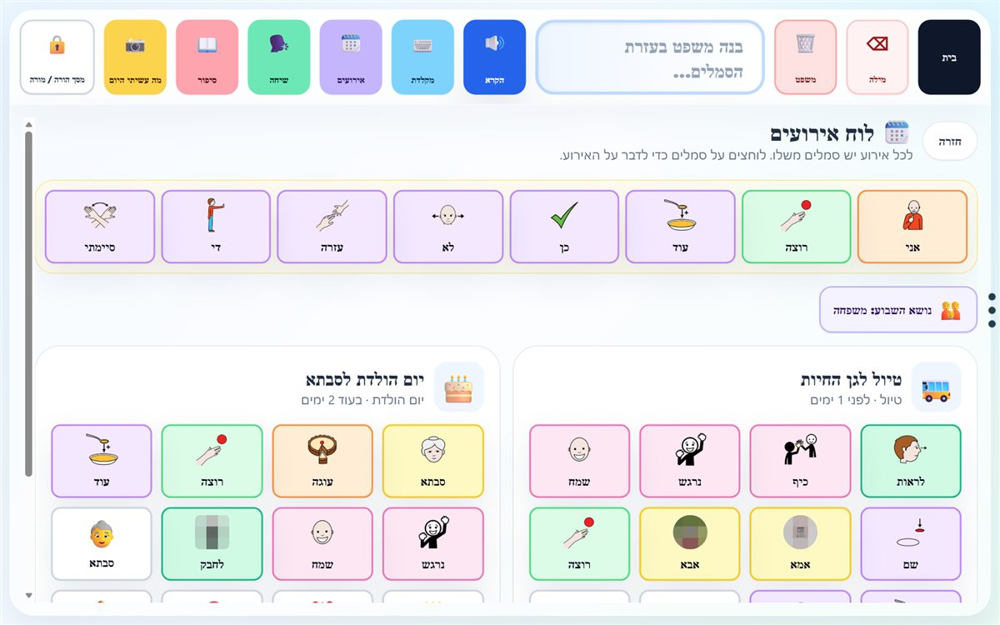</td>
  </tr>
  <tr>
    <td width="55%">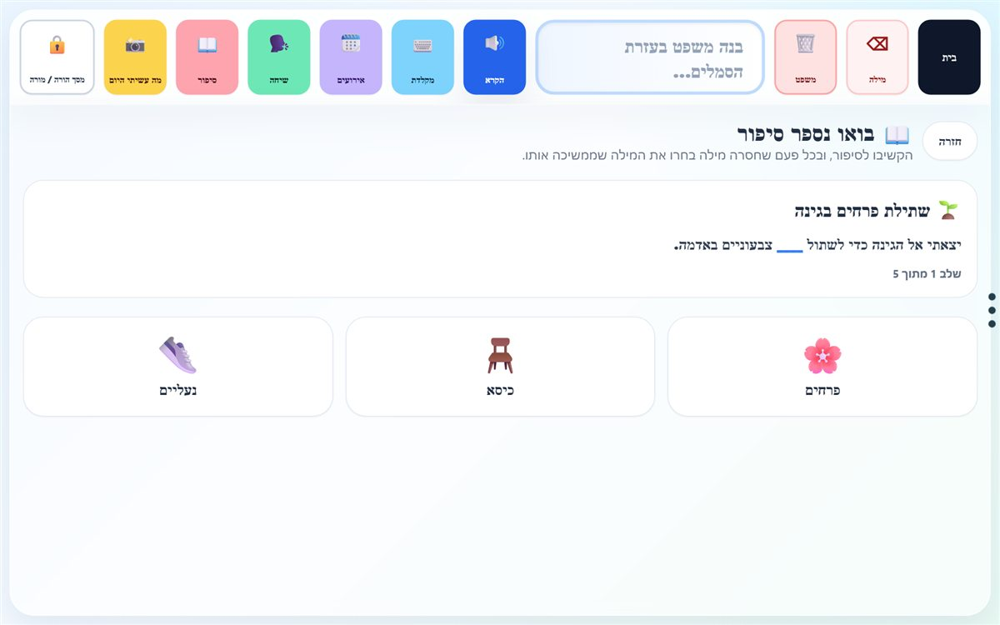</td>
    <td width="45%" valign="middle">
      <h3>📖 סיפור</h3>
      <b>ה-AI כותב סיפור חדש בכל פעם</b>, ובכל שלב חסרה מילה. הילד בוחר את המילה שממשיכה את הסיפור, ושומע את המשפט המלא.<br /><br />
      <sub>אם ה-AI לא זמין, הילד מקבל סיפור מוכן. תמיד יש תחליף.</sub>
    </td>
  </tr>
  <tr>
    <td width="45%" valign="middle">
      <h3>📸 מה עשיתי היום</h3>
      המורה מעלה תמונה מבית הספר, וההורה מהבית. <b>ה-AI בוחר סמלים שקשורים למה שקרה</b>, והילד מספר בעזרתם מה עשה.
    </td>
    <td width="55%">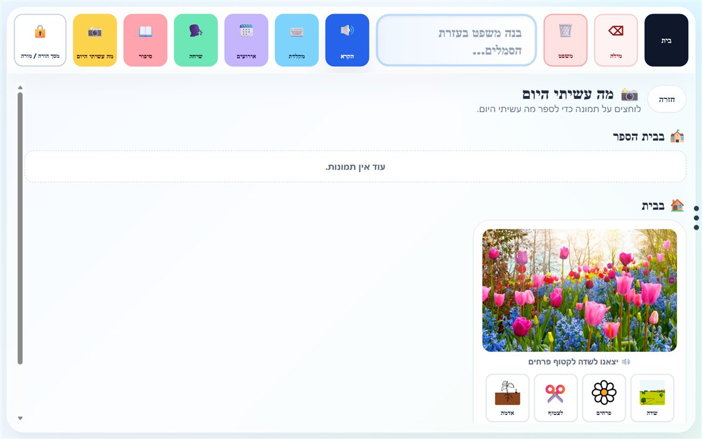</td>
  </tr>
</table>

---

## 👩‍👧 הצד של ההורה והמורה

<p align="center">
  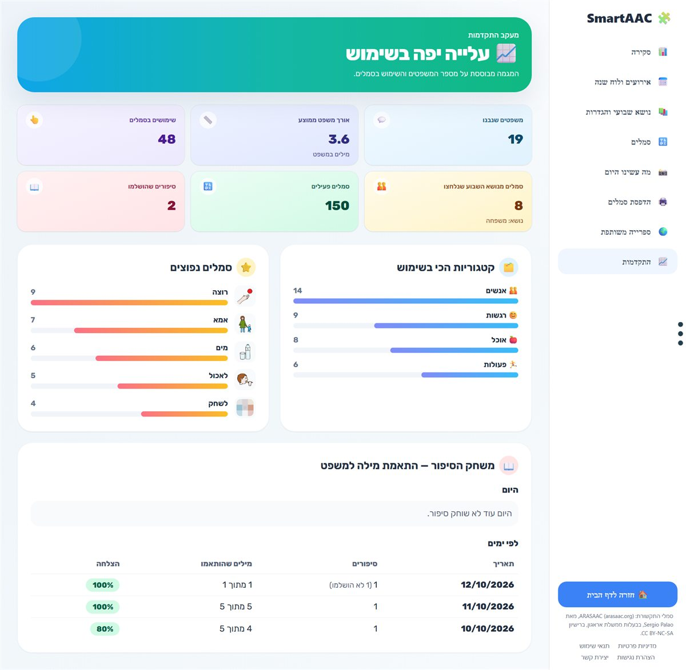
  <br />
  <b>📈 מעקב התקדמות:</b> כמה משפטים, באיזה אורך, אילו סמלים וקטגוריות, ותוצאות משחק הסיפור לפי ימים.
</p>

<table>
  <tr>
    <td width="50%" valign="top">
      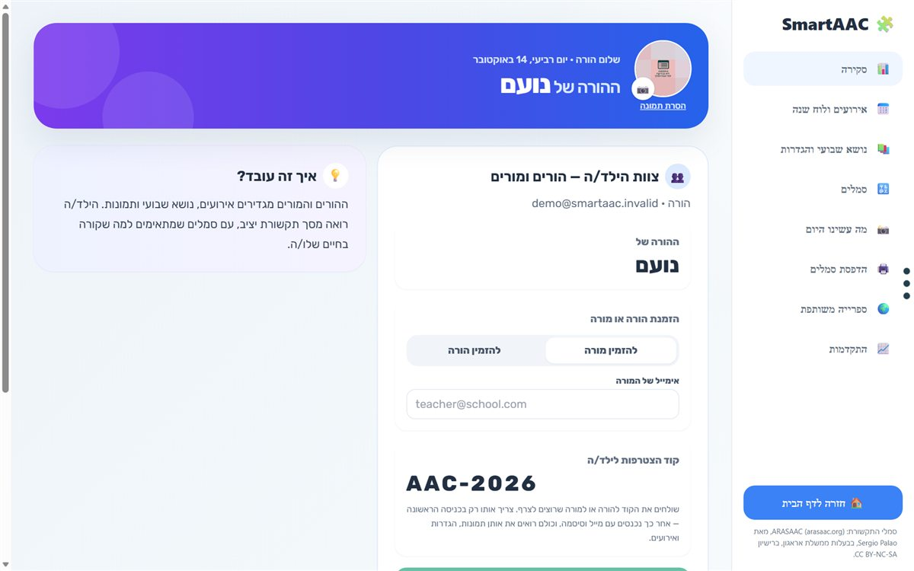
      <br /><b>📊 סקירה:</b> "ההורה של נועם" או "המורה של נועם", הזמנת הצוות, וקוד הילד לשיתוף.
    </td>
    <td width="50%" valign="top">
      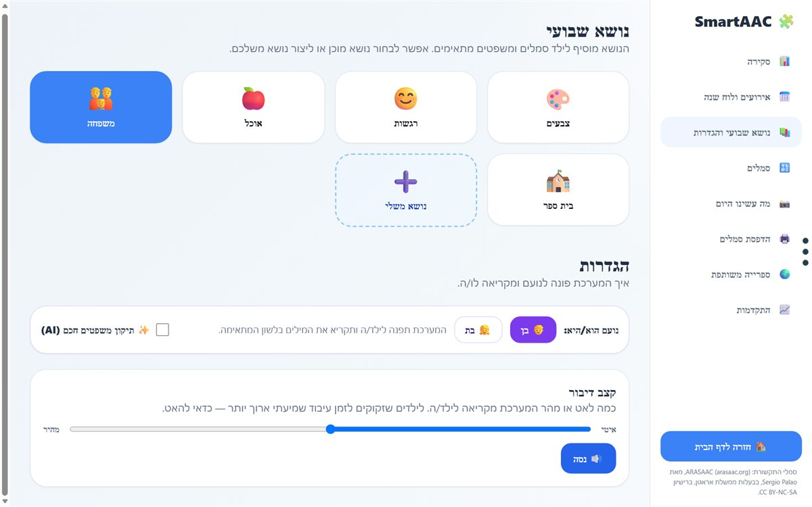
      <br /><b>📚 נושא שבועי והגדרות:</b> בוחרים נושא או יוצרים נושא משלכם, בן או בת, וקצב הקראה.
    </td>
  </tr>
  <tr>
    <td width="50%" valign="top">
      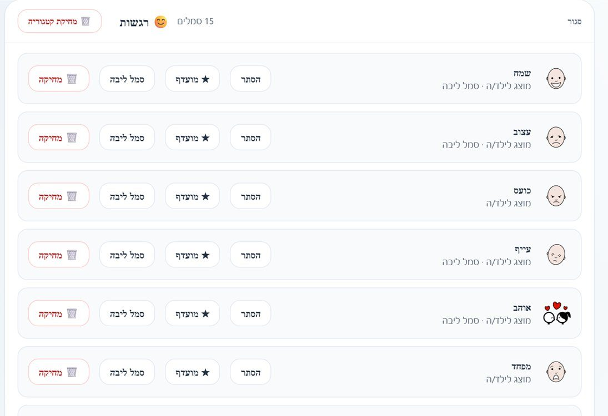
      <br /><b>🔣 סמלים:</b> מעדכנים את סמלי הליבה של הילד, מוסיפים קטגוריות וסמלים, ומפרסמים קטגוריה לספרייה המשותפת.
    </td>
    <td width="50%" valign="top">
      <b>ועוד בדשבורד:</b>
      <ul>
        <li>📅 <b>לוח שנה</b> עם חגים ומועדים</li>
        <li>📸 <b>מה עשינו היום</b>: העלאת תמונות</li>
        <li>🖨️ <b>הדפסת סמלים</b> למשחקי שולחן</li>
        <li>🌍 <b>ספרייה משותפת</b> של לוחות מהורים ומורים אחרים</li>
      </ul>
    </td>
  </tr>
</table>

---

## 📱 המכשיר של הילד

<table>
  <tr>
    <td width="40%" valign="middle">
      <h3>טאבלט שנפתח ישר ללוח</h3>
      ההורה או המורה לוחצים <b>"הפוך למסך של הילד"</b>. מעכשיו, בכל פעם שהילד נכנס, <b>לוח הסמלים מופיע מיד</b>, בלי מסך כניסה ובלי סיסמאות.<br /><br />
      ההגדרות מוגנות ב<b>קוד הורה של 4 ספרות</b>, כך שהילד לא משנה כלום בטעות.
    </td>
    <td width="60%">
      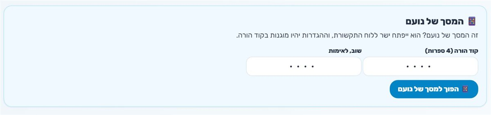<br /><br />
      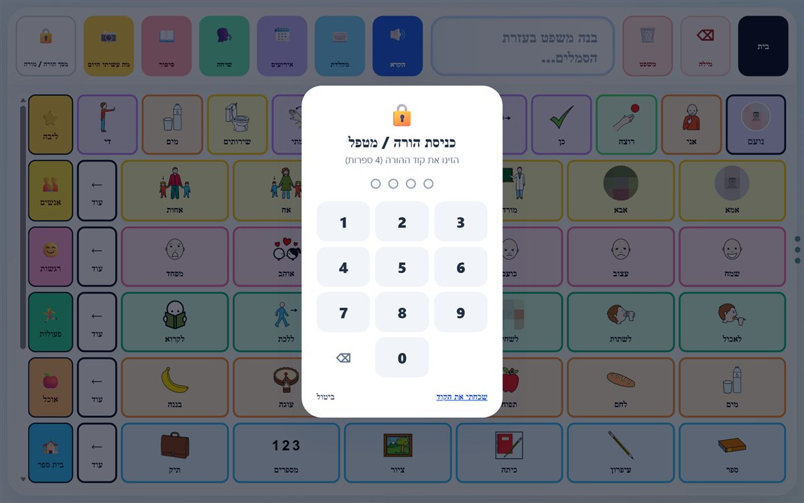
    </td>
  </tr>
</table>

## 📲 גם בטלפון

<p align="center">
  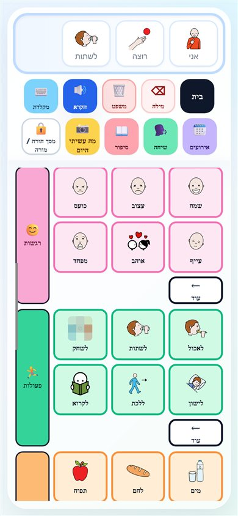
  &nbsp;&nbsp;
  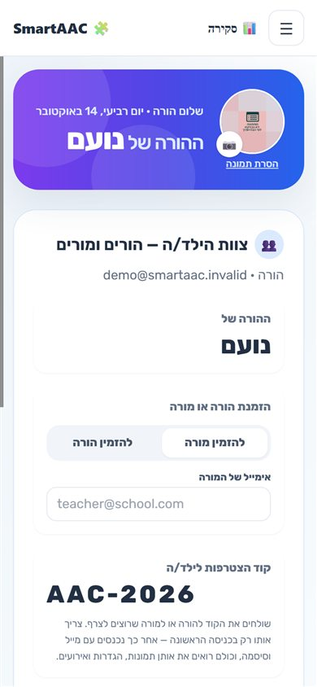
  &nbsp;&nbsp;
  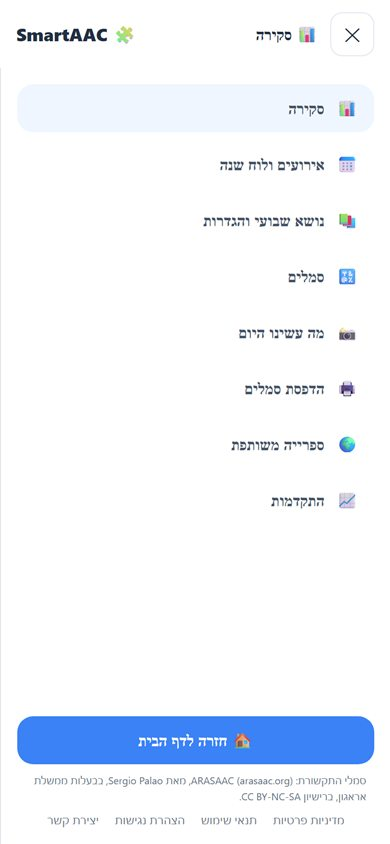
</p>

<p align="center"><sub>הסמלים מסתדרים בשורות של 3, והדשבורד נפתח עם תפריט ☰. עובד מהדפדפן, בלי להתקין אפליקציה.</sub></p>

---

## 🔒 פרטיות ונגישות

- 🛡️ **כל ילד פתוח רק לצוות שלו.** ההרשאות נאכפות במסד הנתונים עצמו (Row Level Security).
- 🙈 **השיחה עם ה-AI וההקלטות לא נשמרות.** תמונות נשמרות באחסון פרטי, עם קישורים זמניים.
- ♿ **נגישות לפי ההנחיות של ת״י 5568:** הגדלה, ניווט במקלדת, קורא מסך וניגודיות.
- 📄 [מדיניות פרטיות](https://smart-aac.vercel.app/privacy) · [תנאי שימוש](https://smart-aac.vercel.app/terms) · [הצהרת נגישות](https://smart-aac.vercel.app/accessibility)

---

<details>
<summary><b>🛠️ למפתחים: טכנולוגיות, הפעלה מקומית ומבנה</b></summary>

<br />

**Full Stack:** צד לקוח ב-**React** ו-**Next.js 14** (App Router, TypeScript, Tailwind CSS). צד שרת ב-**API Routes** של Next.js, שרצים כ-Serverless ב-**Vercel**. מסד נתונים **Postgres** ב-**Supabase**, עם אימות, Row Level Security ו-Storage.

**AI:** **Gemini**, **Groq** ו-**OpenAI**, עם מעבר אוטומטי בין ספקים, ותשובות, סיפורים וסמלים מקומיים כשאין חיבור. **סמלים:** ARASAAC. **מיילים:** Brevo.

### הפעלה מקומית

```powershell
npm install
copy .env.example .env.local   # ומלאו את הערכים
npm run dev                    # http://localhost:3000
```

### משתני סביבה

| משתנה | שימוש | חובה? |
| --- | --- | --- |
| `NEXT_PUBLIC_SUPABASE_URL`, `NEXT_PUBLIC_SUPABASE_ANON_KEY`, `SUPABASE_SERVICE_ROLE_KEY` | Supabase: אימות ומסד נתונים | ✅ |
| `GEMINI_API_KEY`, `GEMINI_MODEL` | סיפורים, סמלים לאירועים ול"מה עשינו היום", תיקון משפטים | מומלץ |
| `GROQ_API_KEY`, `GROQ_MODEL` | שיחה ותמלול קול | מומלץ |
| `BREVO_API_KEY`, `BREVO_SENDER_EMAIL`, `BREVO_SENDER_NAME` | מיילי הזמנה וקוד הילד | מומלץ |
| `OPENAI_API_KEY`, `OPENAI_MODEL` | ספק נוסף לשיחה, והקראה בקול טבעי | לא |
| `APP_BASE_URL` | כתובת האתר לקישורים במיילים (ברירת מחדל: הכתובת ב-Vercel) | לא |

### מסד נתונים

הסכימה נמצאת ב-`supabase/schema.sql`, והשינויים ב-`supabase/migrations/`. מריצים אותם לפי סדר המספור.
ב-Supabase ← Authentication ← URL Configuration: **Site URL** = כתובת האתר, ו-**Redirect URLs** כוללים את
`https://smart-aac.vercel.app/**` ואת `http://localhost:3000/**` (לכניסה עם Google ולאיפוס סיסמה).

### מבנה

```
app/          עמודים ו-API: / , /child/... , /dashboard/... (כתובת לכל מסך), privacy, terms, accessibility
components/
  smartaac-demo.tsx   הלב: מידע הילד, סנכרון עם Supabase, כניסה, כתובות המסכים
  smartaac/           קובץ לכל מסך: child-board, keyboard, child-events, chat, story-game,
                      dashboard, dashboard-events, dashboard-topic, dashboard-symbols,
                      dashboard-progress, child-settings, login, shared
  legal-page.tsx      עמודי הפרטיות, התנאים והנגישות
  daily-story, print-symbols, shared-library, child-device
lib/          AI, אימות, נתוני סמלים, Supabase
supabase/     schema.sql + migrations
docs/         ה-QR לאתר וצילומי המסך
```

### פריסה

כל `push` ל-`main` מתפרס אוטומטית ב-[Vercel](https://vercel.com/). את משתני הסביבה מגדירים גם ב-Vercel ← Settings ← Environment Variables.

</details>

---

<p align="center">
  <a href="https://smart-aac.vercel.app"><b>🚀 לאתר החי: smart-aac.vercel.app</b></a>
</p>

<p align="center"><sub>סמלי התקשורת: <a href="https://arasaac.org">ARASAAC</a>, מאת Sergio Palao, בבעלות ממשלת אראגון, ברישיון CC BY-NC-SA.</sub></p>

</div>
